# Patterned Builds (Threat 6 Amalgamation)

## S Tier

### Jackrabbit – Double Barrel
**Kill Time:** 00:04.501

**Secondary:** Swarm Launcher - Guidance Array
**Grenade:** Incendiary Grenade - Internal Combustion
**Elemental Cocktail:** Fire to Acid

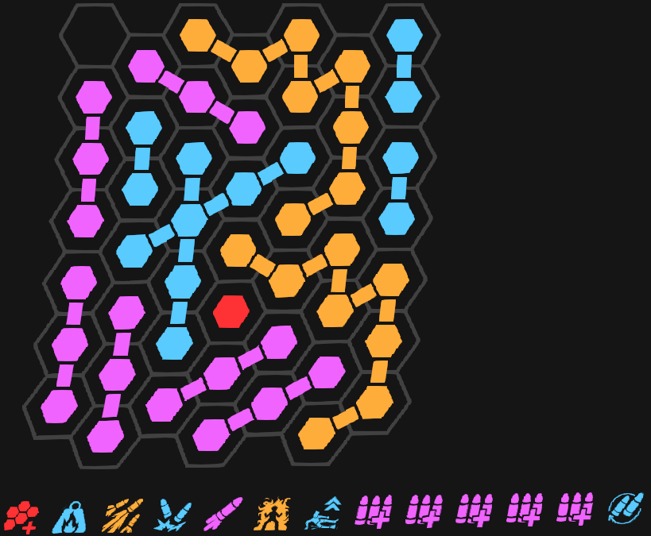

**Upgrades:** Boundary Incursion,Heavy,Pummeler,Double Time,Ghosting,Immolator,Slideshot,Shell Packer x5,Double Barrel

**Comments:**  
Slideshot is the best upgrade in the game. The upgrade does not actually require you to slide, instead if you are in the air, repeatedly tap crouch while sprinting to continuously proc Slideshot. Pummeler is also bugged, so if you bind your reload to your fire key (both together), then you can gain its fire rate without the downside of charging. Ghosting is also the other upgrade which makes this weapon amazing as it gains pierce.

---

### Laser Cannon – Scorched Earth
**Kill Time:** 00:07.972

**Secondary:** Swarm Launcher - Munition Siphon
**Grenade:** Caustic Grenade - Heavy Support
**Elemental Cocktail:** Fire to Acid

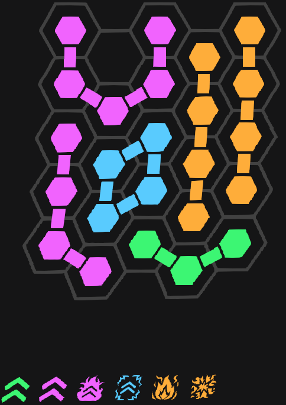

**Upgrades:** Heat Pump,Formicidae Magnifier,Solar Flare,Unruly Crowd,Scorched Earth,Supernova

**Comments:**  
Nothing to really say here, we spawn the weapon and hold left click to fire. It melts the boss. Sadly, since its a heavy weapon, we have to bring the Caustic Grenade for Heavy Support, otherwise Incendiary Grenade would be insanely better.

---

### Jackrabbit – Pummeler
**Kill Time:** 00:08.429

**Secondary:** Swarm Launcher - Guidance Array
**Grenade:** Incendiary Grenade - Internal Combustion
**Elemental Cocktail:** Fire to Acid

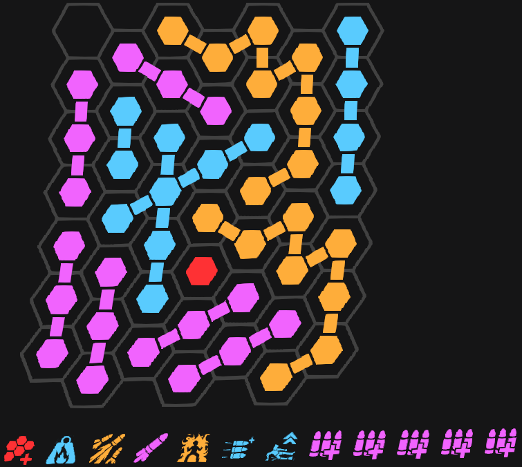

**Upgrades:** Boundary Incursion,Heavy,Pummeler,Ghosting,Immolator,Slam Fire,Slideshot,Shell Packer x5

**Comments:**  
Slideshot is the best upgrade in the game. The upgrade does not actually require you to slide, instead if you are in the air, repeatedly tap crouch while sprinting to continuously proc Slideshot. Pummeler is also bugged, so if you bind your reload to your fire key (both together), then you can gain its fire rate without the downside of charging. Ghosting is also the other upgrade which makes this weapon amazing as it gains pierce.

---

## A Tier

### Lead Flinger – Big Fat Doobie
**Kill Time:** 00:09.552

**Secondary:** Swarm Launcher - Guidance Array
**Grenade:** Incendiary Grenade - Internal Combustion
**Elemental Cocktail:** Fire to Acid

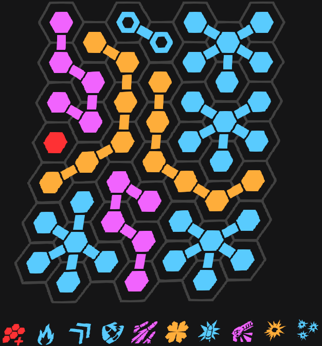

**Upgrades:** Boundary Incursion,Burning Tips,Fan Fire,Home Cooking,Modded Auto,Lucky Bastard,Lucky Last,Double Action,Big Fat Doobie,Shrapnel Loading

**Comments:**  
The Lead Flinger buffs absolutely picked this weapon out of poverty. Gaining elemental damage to self on Home Cooking makes this weapon go from C tier to S tier. The general mechanics here are that we hold left click to fire and watch RNG take place until the target dies. this weapon has always had problems with gambling (since thats its identity), but it is much more consistent now.

---

### Gunship Cannon – Hull Piercer
**Kill Time:** 00:10.539

**Secondary:** Swarm Launcher - Guidance Array
**Grenade:** Incendiary Grenade - Internal Combustion
**Elemental Cocktail:** Fire to Acid

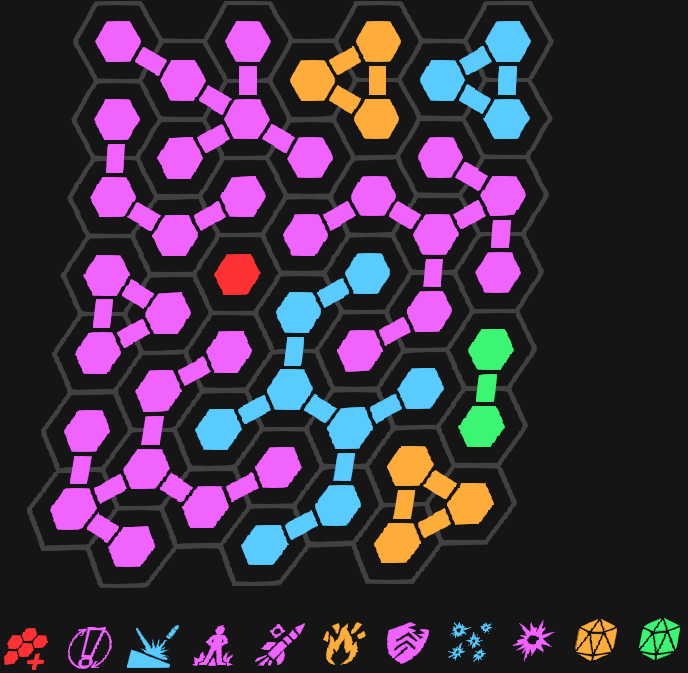

**Upgrades:** Boundary Incursion,Frantic Fingers,Hard Ricochet,Firmly Planted,Ballistic Charger,Tinderbox,Unarmored,Thumper,Hull Piercer,Yellow Prism,Green Prism

**Comments:**  
Since Hull Piercer is the best dps option, we are forced to take Frantic Fingers and Tinderbox. Firmly Planted makes the explosions bigger so we take that, and use Ballistic Charger as our actual main dps because without it, our kill times skyrocket. Hard Ricochet allows us to gain more charge when the bullets get incidental second hits. The main thing here is that while there was a change that allows you to now hold reload to use Frantic Fingers and Tinderbox, it is still higher DPS to mash.

---

### Trident – Lone Cannoneer
**Kill Time:** 00:11.052

**Secondary:** Globbler - The Glob
**Grenade:** Incendiary Grenade - Internal Combustion
**Elemental Cocktail:** Fire to Acid

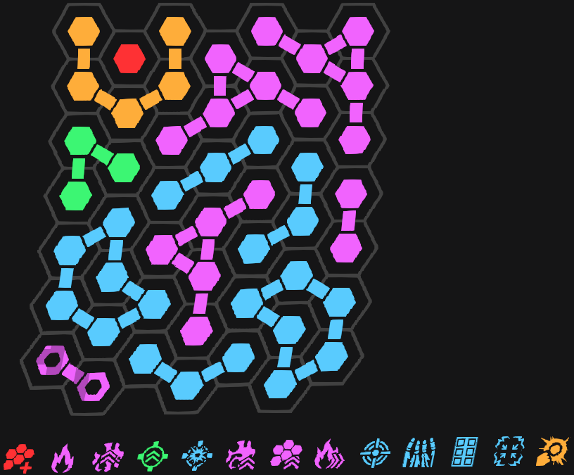

**Upgrades:** Boundary Incursion,Fire Shot,Corrosive Reaction,Compressed Ammunition,Rot Advantage,Tread the Line,Fire in the Hold,Gunpowder Finale,Gunner's Precision,Squadron,Broadside,Ungovernable,Plasma Arc

**Comments:**  
This build is not great in a proper mission setting. The idea is to utilize the Globbler with The Glob and Pressure Cooker to instantly apply acid to ourselves, thus allowing Corrosive Reaction to work. We use fire on the Weapon because we can use Elemental Cocktail to utilize Rot Advantage. This frees up the grenade slot to be Incendiary Grenade for its massive damage buffs. The bug we are abusing is Plasma Arc + Broadside, which allows double plasma projectiles while aiming. Since most of the best upgrades on Trident are rares (blues) maximizing Tread the Lines size is the most important step.

---

### DMLR – Autocycler
**Kill Time:** 00:11.537

**Secondary:** Swarm Launcher - Guidance Array
**Grenade:** Photon Disc - Syzygy
**Elemental Cocktail:** Shock to Acid

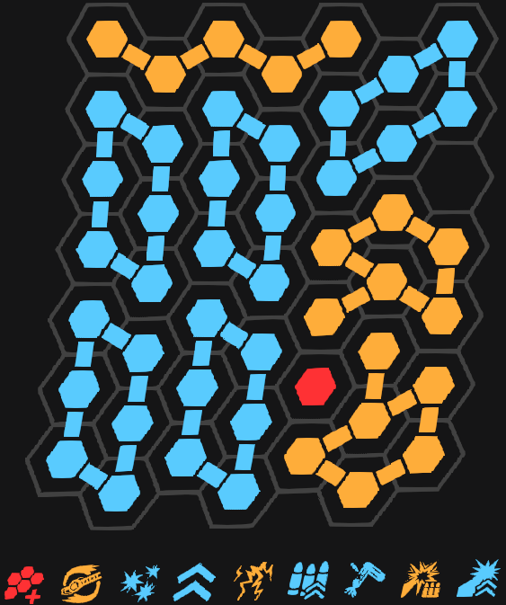

**Upgrades:** Boundary Incursion,Autocycler,Trifecta,Kinetic Amplifier,Arc Lightning,Heavy Hitting,Pulverizer,Hot Swap,Coronal Ejection

**Comments:**  
The best of the worst builds. DMLR's Autocycler has no AOE so we are limited to actually using it in the Amalgamation Hunt. The entire strategy is hold left click to fire, you have infinite ammo. We also bring Photon Disc with Bullet Time since it can generate ammo for us. Normal element also frees up some slots as opposed to fire so we will take it.

---

### Trident – Shredify
**Kill Time:** 00:13.804

**Secondary:** Swarm Launcher - Guidance Array
**Grenade:** Incendiary Grenade - Internal Combustion
**Elemental Cocktail:** Fire to Acid

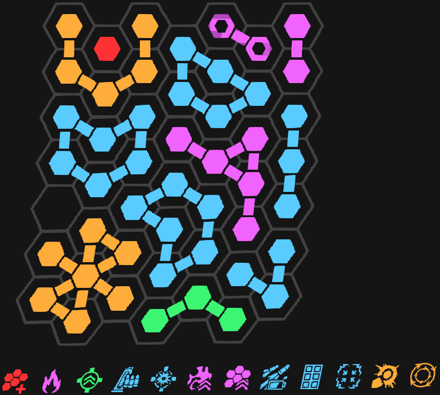

**Upgrades:** Boundary Incursion,Fire Shot,Line Er' Up,Top Deck Storage,Lone Cannoneer,Rot Advantage,Tread the Line,Energy Condenser,Broadside,Ungovernable,Plasma Arc,Shredify

**Comments:**  
Shredify is a much simpler build than the other 2 for the Trident, and is actually usable in a normal mission. The bug we are abusing is Plasma Arc + Broadside, which allows double plasma projectiles while aiming. We use fire on the Weapon because we can use Elemental Cocktail to utilize Rot Advantage. This frees up the grenade slot to be Incendiary Grenade for its massive damage buffs. Since most of the best upgrades on Trident are rares (blues) maximizing Tread the Lines size is the most important step.

---

### Globbler – Flood
**Kill Time:** 00:15.387

**Secondary:** Swarm Launcher - Guidance Array
**Grenade:** Caustic Grenade - Heavy Support
**Elemental Cocktail:** Acid to Fire

**Upgrades:** Boundary Incursion,Impact Funnel,Full Spectrum,Improved Replication,Globblin,Pocket Replication,Auto-Replicator,Glorb,Heavy Globs,Pressure Cooker,Globulous Excitement,Flood,Triagon

**Comments:**  
Globbler is still amazing at its job, it just got knocked into place to be a more average weapon. We are shooting the ground instead of direct fire after the first shot [to get it on the ground] to get flood procs. The 3 other main mechanics here are we want to take damage purposefully on the first shot to fully charge Impact Funnel, before each shot we want to melee so as to count as a "weapon swap" for Globulous Excitement, and lastly we want to fully charge our Pressure Cooker for each shot.

---

## B Tier

### Gunship Cannon – Thumper
**Kill Time:** 00:15.569

**Secondary:** Swarm Launcher - Guidance Array
**Grenade:** Incendiary Grenade - Internal Combustion
**Elemental Cocktail:** Fire to Acid

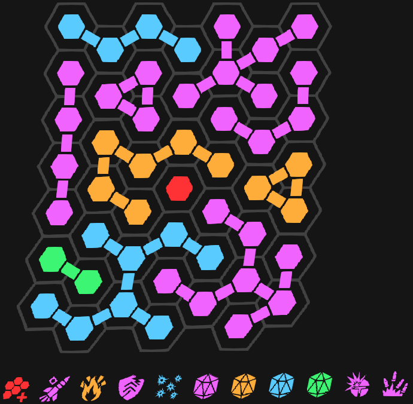

**Upgrades:** Boundary Incursion,Ballistic Charger,Tinderbox,Unarmored,Thumper,Purple Prism,Yellow Prism,Blue Prism,Green Prism,Point Demolition, Safety Regulations

**Comments:**  
Since Hull Piercer is the best dps option, we are forced to take Frantic Fingers and Tinderbox. Missile Bay isnt really a build i like to run because you are wasting slots for auto aim instead of damage. but if you want to run it theres nothing stopping you. Since we have replaced our projectiles with missiles we run Point Demolition since we lose AOE anyway. The main thing here is that while there was a change that allows you to now hold reload to use Frantic Fingers and Tinderbox, it is still higher DPS to mash.

---

### Photon Disc – Bullet Time
**Kill Time:** 00:17.084

**Secondary:** Swarm Launcher - Guidance Array
**Grenade:** n/a
**Elemental Cocktail:** Shock to Acid

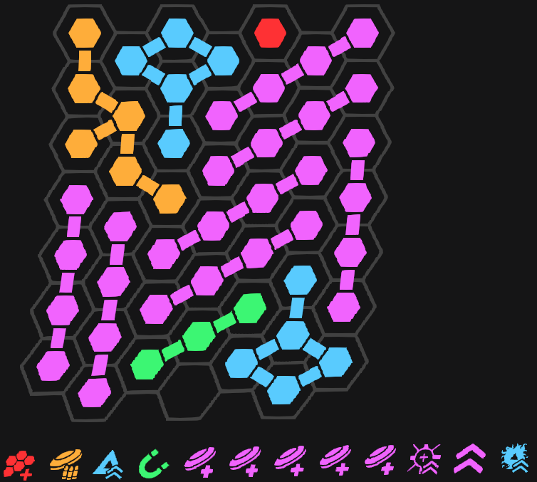

**Upgrades:** Boundary Incursion,Bullet Time,Perfectly Attuned,Steel Frame,Photon Lattice x5,Splinter,Flurry,Elemental Obsession

**Comments:**  
Photon Grenade is much more than a grenade when built, it is a weapon in and of itself. Bullet Time allows us to utilize our ammo pools as extra grenade charges. Normal Attunement since it grants a damage bonus.

---

### Gunship Cannon – Lagrange Halo
**Kill Time:** 00:18.583

**Secondary:** Swarm Launcher - Guidance Array
**Grenade:** Incendiary Grenade - Internal Combustion
**Elemental Cocktail:** Fire to Acid

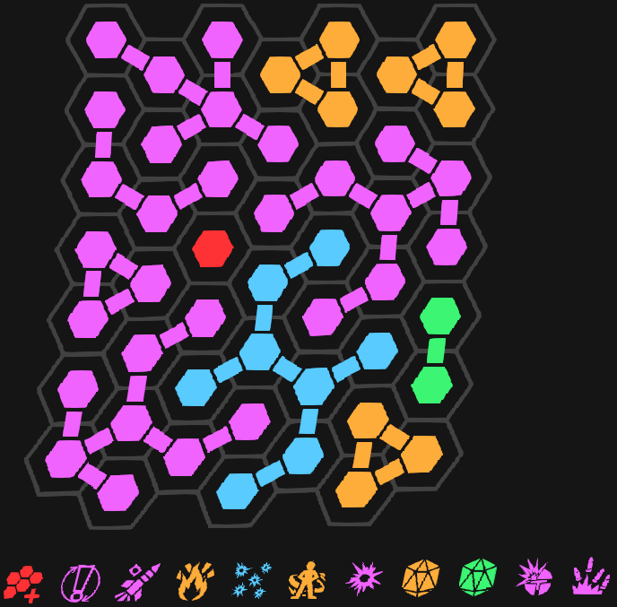

**Upgrades:** Boundary Incursion,Frantic Fingers,Ballistic Charger,Tinderbox,Thumper,Lagrange Halo,Hull Piercer,Yellow Prism,Green Prism,Point Demolition,Safety Regulations

**Comments:**  
Since Hull Piercer is the best dps option, we are forced to take Frantic Fingers and Tinderbox. Halo allows you to sprint while firing at the cost of essentially being in melee. Since we have replaced our projectiles with orbitals we run Point Demolition since we lose AOE anyway. The main thing here is that while there was a change that allows you to now hold reload to use Frantic Fingers and Tinderbox, it is still higher DPS to mash.

---

### Cycler – Infinity Burn
**Kill Time:** 00:18.597

**Secondary:** Swarm Launcher - Guidance Array
**Grenade:** Incendiary Grenade - Internal Combustion
**Elemental Cocktail:** Fire to Acid

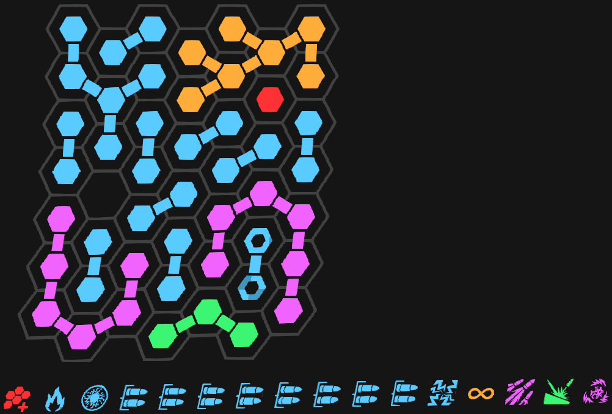

**Upgrades:** Boundary Incursion,Heated Battery,Condensed Ejection,Double Shot x8,Energy Convergence,Infinity Burn,Mass Acceleration,Ricochet,Toxin Recycling

**Comments:**  
Cycler is currently being held up by a bug, without it this weapon falls off a cliff. We start a mission by shooting to gain a stack of Energy Convergence, then we consume the stack. This makes the weapon usable from there due to the bug. The main source of damage we have is actually the Incendiary Grenade's Internal Combustion, don't be fooled into thinking this weapon is good.

---

### Trident – Broadside
**Kill Time:** 00:19.017

**Secondary:** Globbler - The Glob
**Grenade:** Incendiary Grenade - Internal Combustion
**Elemental Cocktail:** Fire to Acid

**Upgrades:** Boundary Incursion,Fire Shot,Corrosive Reaction,Line Er' Up,Lone Cannoneer,Rot Advantage,Tread the Line,Fire in the Hold,Gunner's Precision,Squadron,Broadside,Ungovernable,Plasma Arc

**Comments:**  
This build is not great in a proper mission setting. The idea is to utilize the Globbler with The Glob and Pressure Cooker to instantly apply acid to ourselves, thus allowing Corrosive Reaction to work. We use fire on the Weapon because we can use Elemental Cocktail to utilize Rot Advantage. This frees up the grenade slot to be Incendiary Grenade for its massive damage buffs. Since most of the best upgrades on Trident are rares (blues) maximizing Tread the Lines size is the most important step. Lastly for this build specifically, Broadside gives us the ability to utilize Gunpowder Finale. We need specifically a Compressed Ammunition with the roll of 9 magazine size for the proper magazine of 90 so our last shot has all 6 bullets (you could also run a roll of 3).

---

### Cycler – Cyclotron
**Kill Time:** 00:19.755

**Secondary:** Swarm Launcher
**Grenade:** Photon Disc - Syzygy
**Elemental Cocktail:** Shock to Acid

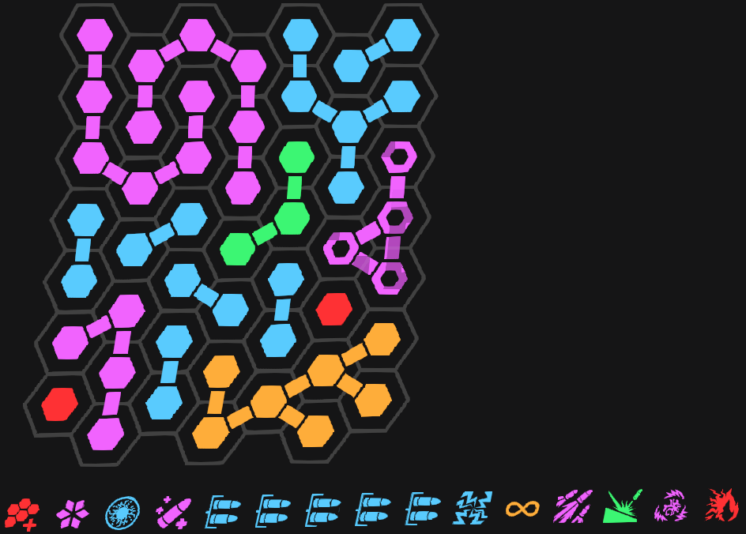

**Upgrades:** Boundary Incursion,Subzero Energy,Condensed Ejection,Cycling Repairs,Double Shot x5,Energy Convergence,Infinity Burn,Mass Acceleration,Ricochet,Toxin Recycling,Cyclotron

**Comments:**  
Cycler is currently being held up by a bug, without it this weapon falls off a cliff. We start a mission by shooting to gain a stack of Energy Convergence, then we consume the stack. This makes the weapon usable from there due to the bug. Our goal here is to gain as much damage as possible with Photon Disc's Syzygy due to our elemental cycling. Then once Toxin Recycling is stacked, we have the ability to utilize Cryo properly to constantly shatter targets.

---

### Shocklance – Auger Subroutine
**Kill Time:** 00:19.962

**Secondary:** Swarm Launcher - Guidance Array
**Grenade:** Incendiary Grenade - Internal Combustion
**Elemental Cocktail:** Fire to Acid

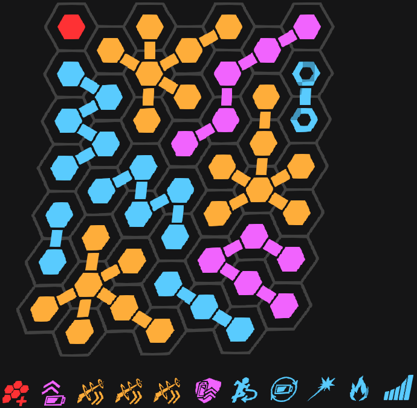

**Upgrades:** Boundary Incursion,Black Market Battery,Auger Subroutine x3,Gearshift,Centripetal Cornering,Flurrying Configuration,Railshot,Fwoosh,Half Cocked

**Comments:**  
We utilize the alternate firing mode on Auger Subroutine here. We only care about this firing mode. Charge to yellow charge (about half way) is generally the accepted optimal charge, since it balances damage and control. Ram your face into the enemy with this drill.

---

### Lead Flinger – Self-Storage
**Kill Time:** 00:19.962

**Secondary:** Swarm Launcher - Guidance Array
**Grenade:** Incendiary Grenade - Internal Combustion
**Elemental Cocktail:** Fire to Acid

**Upgrades:** Boundary Incursion,Burning Tips,Fan FIre,Home Cooking,Modded Auto,Lucky Bastard,Lucky Last,Self Storage,Shrapnel Loading

**Comments:**  
The Lead Flinger buffs absolutely picked this weapon out of poverty. Gaining elemental damage to self on Home Cooking makes this weapon go from C tier to S tier. The general mechanics here are that we hold left click to fire and watch RNG take place until the target dies. this weapon has always had problems with gambling (since thats its identity), but it is much more consistent now. The difference with this build is that we have a higher fire rate due to the exclusion of Big Fat Doobie and Double Action.

---

### Plate Launcher – Damage Arc
**Kill Time:** 00:22.120

**Secondary:** Swarm Launcher - Guidance Array
**Grenade:** Voltaic Grenade - Livewire
**Elemental Cocktail:** Shock to Acid

**Upgrades:** Boundary Incursion,Electrified Plates,Clearing Plasma,Damage Arc,Aerodynamic Plates,Compressed Plate Storage,Fencing Construction,Slap-Job,Power Recall,Pole Alignment,Salad Plates

**Comments:**  
This is the classic Plate Launcher build, we take all of the original exotics and slap them together for a very good combination. Unfortunately in this era the weapon plays a little differently. With a max sized fencing construction it out DPS's the actual weapon if you were to be firing it. So we stick in the plates and then wait, then stick them in again when they fall out.

---

### Accelerator – Inertia Accelerant
**Kill Time:** 00:27.101

**Secondary:** Swarm Launcher - Guidance Array
**Grenade:** Voltaic Grenade - Livelier
**Elemental Cocktail:** Shock to Acid

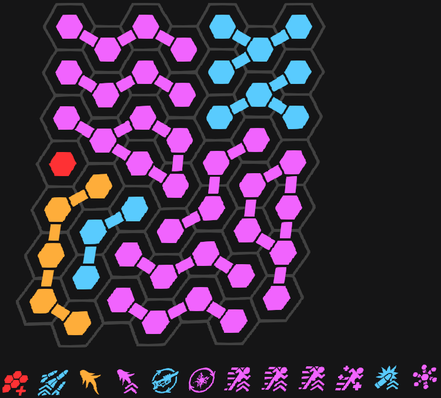

**Upgrades:** Boundary Incursion,Hair Trigger,Payback,Oxythane's Promise,Full-Auto Trigger,Remote Charging,Inertia Accelerant x3,The Royal Jelly of Hazaran,Momentum Impact,Unstable Recursion

**Comments:**  
The Accelerator thrives on pumping out as many bursts as fast as possible. You are essentially playing for Payback and Oxythane's Promise for your damage. Which is why we run Voltaic Grenade with Livewire for the self damage.

---

### Diffraction Driver – Pocket Sniper
**Kill Time:** 00:27.197

**Secondary:** Swarm Launcher - Guidance Array
**Grenade:** Incendiary Grenade - Internal Combustion
**Elemental Cocktail:** Fire to Acid

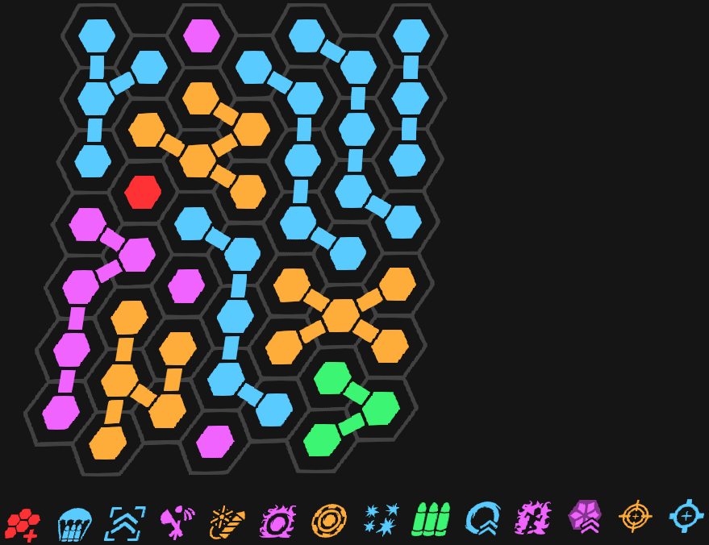

**Upgrades:** Boundary Incursion,Aerial Refueling,Quite the Tussle,Resonance Catapult,Firecracker,Elemental Infusion,Patient Gambler,Quadrabarrel,Generative Ions,Full Potential,Illegal Sprinting Technique,Frostbiter,Pocket Sniper,Saxonite Dampeners

**Comments:**  
Diffraction Driver relies on RNG from Patient Gambler, so its not exactly consistent. Our Pocket Sniper build relies on an interesting strategy, by mixing fire element from Elemental Infusion and Cryo element from Resonance Catapult and Frostbiter. This entire build would be much stronger had the game not done the math in the order of Pocket Sniper's flat damage is calculated after Patient Gambler and Frostbiter.  Just stay in the air for the ammo generation.

---

## C Tier

### Plate Launcher – Vector Interdiction
**Kill Time:** 00:29.083

**Secondary:** Swarm Launcher - Guidance Array
**Grenade:** Voltaic Grenade - Livewire
**Elemental Cocktail:** Shock to Acid

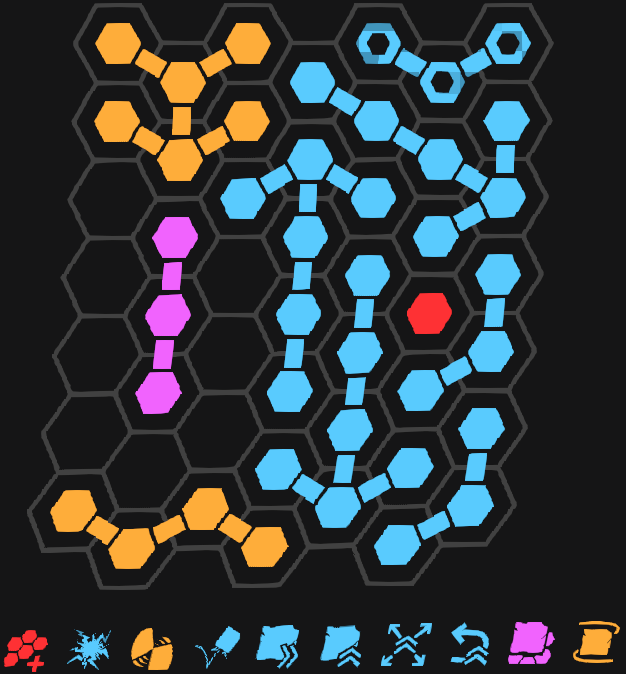

**Upgrades:** Boundary Incursion,Electrified Plates,Clearing Plasma,Bouncy Plates,Rail-Tuning,Weight Rebalanced,Slap-Job,Power Recall,Storage Surplus,Vector Interdiction

**Comments:**  
Vector Interdiction is the most fun way to play this game. It makes the plate into a projectile you can control. We utilize this by allowing our plate to bounce around which gains damage bonuses when it lands on the target. This was originally removed from the upgrade as a synergy, but we begged hard enough to get it back since it was awful without it.

---

### Swarm Launcher – Mitosis
**Kill Time:** 00:29.608

**Secondary:** Shocklance - Compressor
**Grenade:** Voltaic Grenade - Livewire
**Elemental Cocktail:** Shock to Acid

**Upgrades:** Boundary Incursion,Electrified Pellets,Crop Duster,Tool for the Job,Swarm Reserves,Wait Charging,Large Energy Storage,The Hive Must Grow,Mitosis,Rapid Pollination,Remote Control,Static Reload,Scatterburst,High Caliber Pellets

**Comments:**  
Mitosis is an interesting build, you stack up a bunch of pellets and watch them rain. The main balancing point is when to release the swarm. Generally Wait Charging is going to determine when you should release, but otherwise its when you run out of ammo. The build centers around The Hive Must Go, all upgrades should touch it if possible for the highest magazine size increase.

---

### Cycler – Shock Recursion
**Kill Time:**  00:29.900

**Secondary:** Swarm Launcher - Guidance Array
**Grenade:**  Voltaic Grenade - Livewire
**Elemental Cocktail:**  Shock to Acid

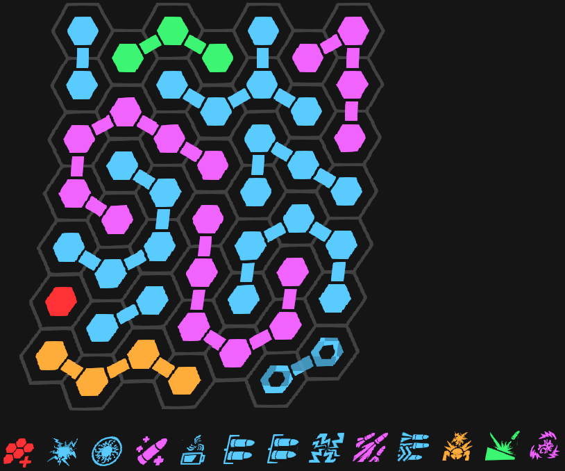

**Upgrades:** "Boundary Incursion

**Comments:**  
Charged Cartridges

---

### Cycler – Corrode Siphon
**Kill Time:**  00:31.298

**Secondary:** Swarm Launcher - Guidance Array
**Grenade:**  Photon Disc - Syzygy
**Elemental Cocktail:**  Acid to Fire

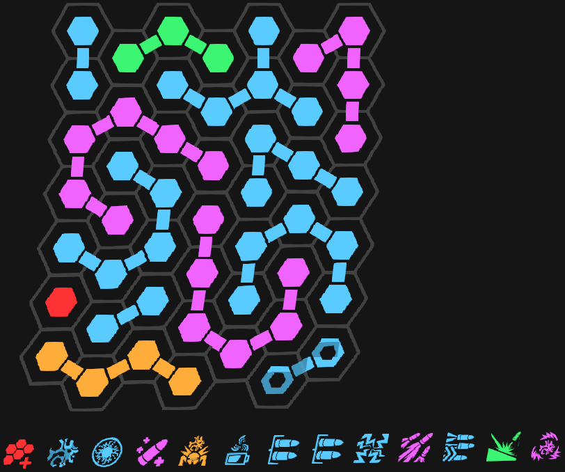

**Upgrades:** "Boundary Incursion

**Comments:**  
Corrosive Plasma

---

### Street Sweeper – Melodramatic Hero
**Kill Time:** 00:32.658

**Secondary:** Swarm Launcher - Munition Siphon
**Grenade:** Caustic Grenade - Heavy Support
**Elemental Cocktail:** Acid to Fire

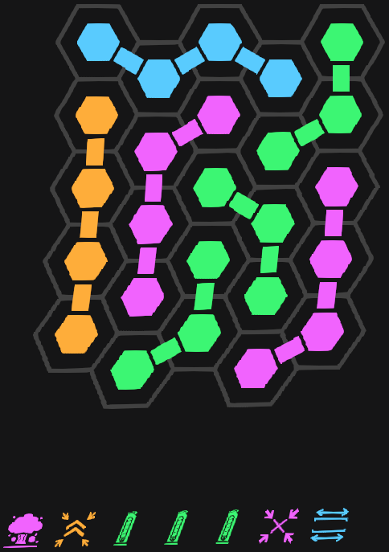

**Upgrades:** Acerbic Flush,Melodramatic Hero,Double Loading x3,G6 Choke,Corn All Around the Cob

**Comments:**  
Not a bad weapon after the massive buffs, but certainly still not competitive. Drop a bunch of shotguns before the Amalgamation spawns and then swap them out as you run out of ammo. All heavy weapons are bugged so that any magazine or ammo capacity upgrades do not actually come filled when you spawn them. Making many builds worse.

---

### Accelerator – Ruptured Spleen
**Kill Time:** 00:32.744

**Secondary:** Swarm Launcher - Guidance Array
**Grenade:** Voltaic Grenade - Livelier
**Elemental Cocktail:** Shock to Acid

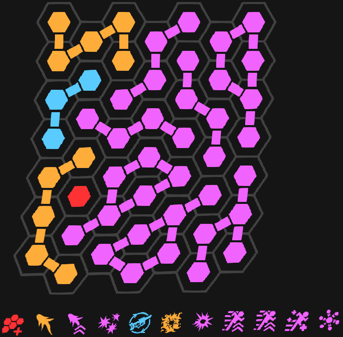

**Upgrades:** Boundary Incursion,Payback,Oxythane's Promise,Three-in-One,Full-Auto Trigger,Slipspace Bullet Transfer,Ruptured Spleen,Inertia Accelerant x2,The Royal Jelly of Hazaran,Unstable Recursion

**Comments:**  
In this build instead of as many bursts as possible, we are going for the largest burst possible. You are essentially playing for Payback and Oxythane's Promise for your damage. Which is why we run Voltaic Grenade with Livewire for the self damage.

---

### Plate Launcher – Auto-Demolition
**Kill Time:** 00:33.336

**Secondary:** Swarm Launcher - Guidance Array
**Grenade:** Voltaic Grenade - Livewire
**Elemental Cocktail:** Shock to Acid

**Upgrades:** Boundary Incursion,Electrified Plates,Auto-Demolition,Clearing Plasma,Aerodynamic Plates,Simple Inertia,Shish Kebab,Weight Rebalanced,Compressed Plate Storage,Slap-Job,Power Recall,Salad Plates

**Comments:**  
This build focuses purely on shooting plates. Nothing more complex than that, just keep firing. We add pierce so that we can double dip on the damage as much as possible.

---

### Accelerator – Requeening
**Kill Time:** 00:34.292

**Secondary:** Swarm Launcher - Guidance Array
**Grenade:** Voltaic Grenade - Livelier
**Elemental Cocktail:** Shock to Acid

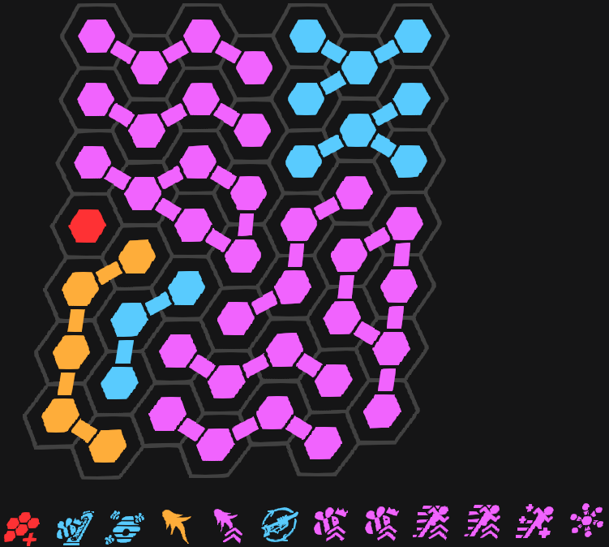

**Upgrades:** Boundary Incursion,Confident Queen,Awaken the Hive,Payback,Oxythane's Promise,Full-Auto Trigger,Requeening x2,Inertia Accelerant x2,The Royal Jelly of Hazaran,Unstable Recursion

**Comments:**  
With a bee build, Accelerator no longer wants to never reload and instead is required to reload after each self inflicted bee saturation runs out. You are essentially playing for Payback and Oxythane's Promise for your damage. Which is why we run Voltaic Grenade with Livewire for the self damage. This is precisely why we never run the bee element, since bees have no way to be amplified as an elemental damage type, so even on the bee build we run shock.

---

### Shocklance – Railshot
**Kill Time:** 00:34.750

**Secondary:** Swarm Launcher - Guidance Array
**Grenade:** Incendiary Grenade - Internal Combustion
**Elemental Cocktail:** Fire to Acid

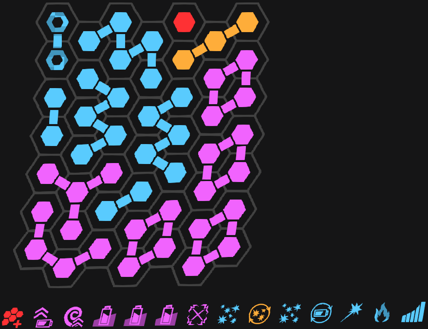

**Upgrades:** Boundary Incursion,Black Market Battery,Killing Field,Ready and Waiting x3,Extra Capacitors,Splintered Lance,Battery Recursion,Notched Breakpoint,Flurrying Configuration,Railshot,Fwoosh,Half Cocked

**Comments:**  
While Railshot is inferior to Compressor generally, it is better in Amalgamation Hunt. The extra damage allows us to eek out a bit more DPS. Battery Recursion is utilized here because even when i was optimally shooting semi-auto with the Shocklance, i noticed i just couldnt keep up in DPS with the automatic mode, suggesting theres some level of charge rate increase on the upgrade that is hidden.

---

### Jackrabbit – Pesticide
**Kill Time:** 00:35.277

**Secondary:** Swarm Launcher - Guidance Array
**Grenade:** Incendiary Grenade - Internal Combustion
**Elemental Cocktail:** Fire to Acid

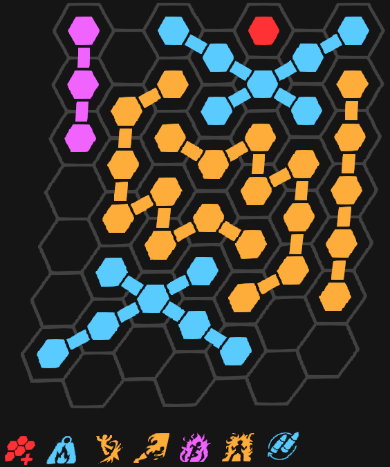

**Upgrades:** Boundary Incursion,Heavy,All Powdered Up,Pesticide,Fire in my Heart,Immolator,Double Barrel

**Comments:**  
This build is purely hold aim. Nothing else, the flamethrower is a cylinder that pierces all targets so get up close and slowly melt them. This build isnt great but it works. The main extra mechanic here is utilizing the height differential bonus on All Powdered Up for the bonus damage.

---

### Swarm Launcher – Guidance Array
**Kill Time:** 00:35.935

**Secondary:** Shocklance - Compressor
**Grenade:** Voltaic Grenade - Livewire
**Elemental Cocktail:** Shock to Acid

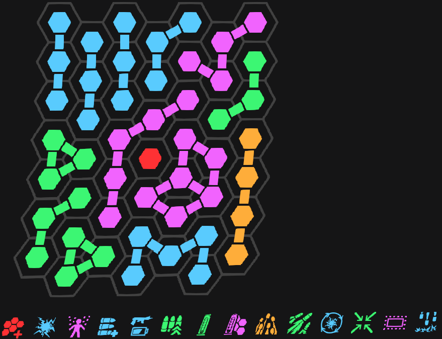

**Upgrades:** Boundary Incursion,Electrified Pellets,Crop Duster,Atmospheric Energizers,Tool for the Job,Swarm Reserves,Large Energy Storage,The Hive Must Grow,Guidance Array,Rapid Pollination,Static Reload,Tight Planting,Scatterburst,High Caliber Pellets

**Comments:**  
Guidance Array removes the annoying translocation firing. Allowing us to properly aim our weapon at the target. The build centers around The Hive Must Go, all upgrades should touch it if possible for the highest magazine size increase.

---

### Diffraction Driver – Cryogenic Firing Chamber
**Kill Time:** 00:39.750

**Secondary:** Swarm Launcher - Guidance Array
**Grenade:** Snowball - Serious Squall
**Elemental Cocktail:** Shock to Acid

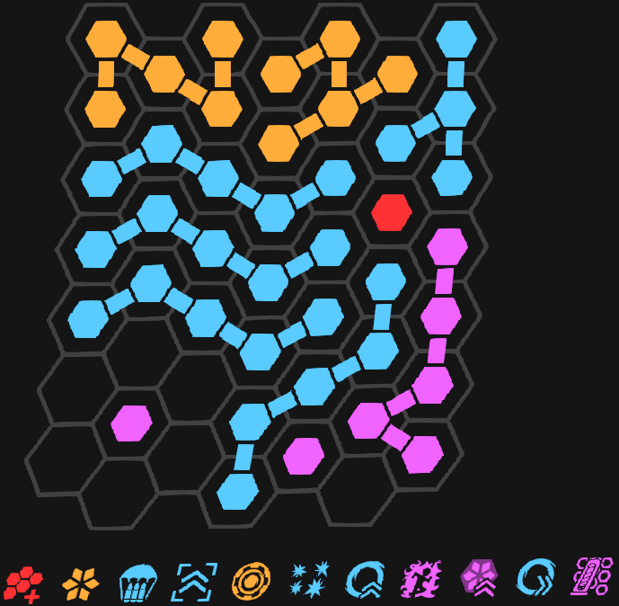

**Upgrades:** Boundary Incursion,Cryogenic Firing Chamber,Aerial Refueling,Quite the Tussle,Patient Gambler,Quadrabarrel,Full Potential,Illegal Sprinting Technique,Frostbiter,Terminal Velocity,Capacity Waiver Section B

**Comments:**  
Diffraction Driver relies on RNG from Patient Gambler, so its not exactly consistent. The strategy with running Snowball's Shardburst which we are going to be heavily abusing, is to hit the enemy from above, since these shards rain downward. Otherwise its about dancing on top of your enemy attempting to not get hit, because Snowball doesn't have good healing. Just stay in the air for the ammo generation.

---

### DMLR – Concussive Wave
**Kill Time:** 00:41.441

**Secondary:** Swarm Launcher - Guidance Array
**Grenade:** Voltaic Grenade - Livewire
**Elemental Cocktail:** Shock to Acid

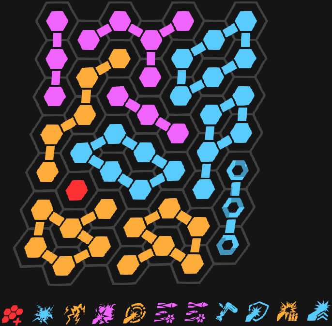

**Upgrades:** Boundary Incursion,Shocking Laser,Arc Lightning,Hazard Recycling,Concussive Wave,Stormcloud Accumulator x2,Pulverizer,Sturdy,Hot Swap,Coronal Ejection

**Comments:**  
The idea of the dedicated laser build works much better outside of Amalgamation Hunt. If you do take this out of this mission, remove Coronal Ejection as it makes your weapon no longer infinite hold left click. The basic premise is Voltaic Grenade's Livewire constantly shocks us, which enables Hazard Recycling to refill the battery constantly.

---

## D Tier

### Shocklance – Compressor
**Kill Time:** 00:41.761

**Secondary:** Swarm Launcher - Guidance Array
**Grenade:** Incendiary Grenade - Internal Combustion
**Elemental Cocktail:** Fire to Acid

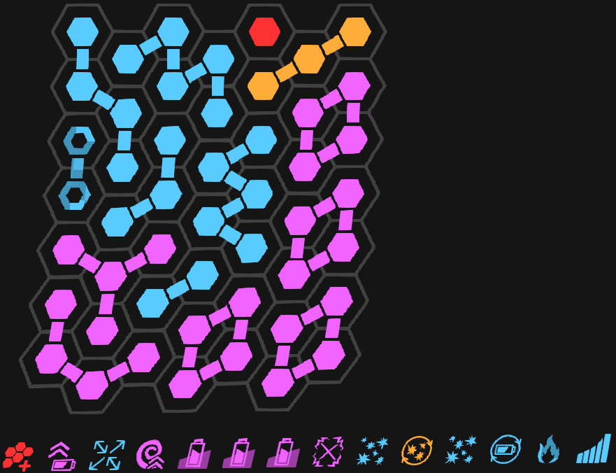

**Upgrades:** Boundary Incursion,Black Market Battery,Compressor,Killing FIeld,Ready and Waiting x3,Extra Capacitors,Splintered Lance,Battery Recursion,Notched Breakpoint,Flurrying Configuration,Fwoosh,Half Cocked

**Comments:**  
Compressor build is not great overall for bossing, its true power is in horde clear. If we werent evaluating builds on bossing id include Micro Detonators on the build. Battery Recursion is utilized here because even when i was optimally shooting semi-auto with the Shocklance, i noticed i just couldnt keep up in DPS with the automatic mode, suggesting theres some level of charge rate increase on the upgrade that is hidden.

---

### Diffraction Driver – Capacity Waiver
**Kill Time:** 00:42.115

**Secondary:** Swarm Launcher - Guidance Array
**Grenade:** Incendiary Grenade - Internal Combustion
**Elemental Cocktail:** Fire to Acid

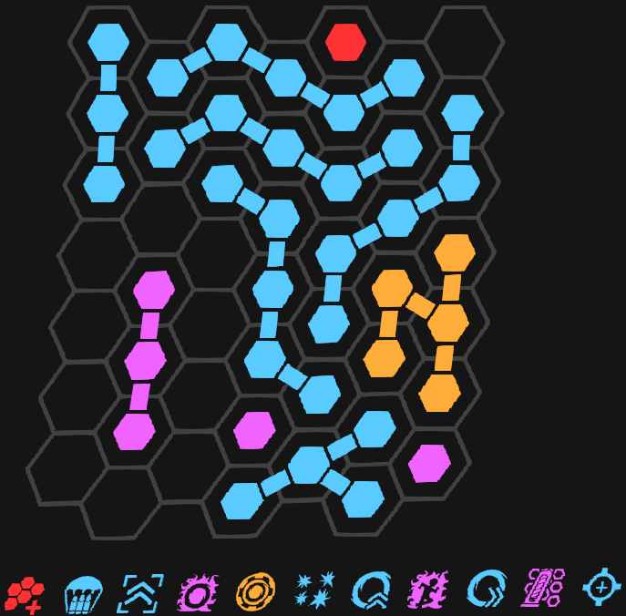

**Upgrades:** Boundary Incursion,Aerial Refueling,Quite the Tussle,Elemental Infusion,Patient Gambler,Quadrabarrel,Full Potential,Illegal Sprinting Technique,Terminal Velocity,Capacity Waiver Section B,Saxonite Dampeners

**Comments:**  
Diffraction Driver relies on RNG from Patient Gambler, so its not exactly consistent. This is the most straightforward DD build. We will be abusing Illegal Sprinting Techniques synergy with Incendiary Grenade's Internal Combustion to become an immortal bomber. Just stay in the air for the ammo generation.

---

### Carver – Rage
**Kill Time:** 00:48.881

**Secondary:** Swarm Launcher - Guidance Array
**Grenade:** Photon Disc - Syzygy
**Elemental Cocktail:** Shock to Acid

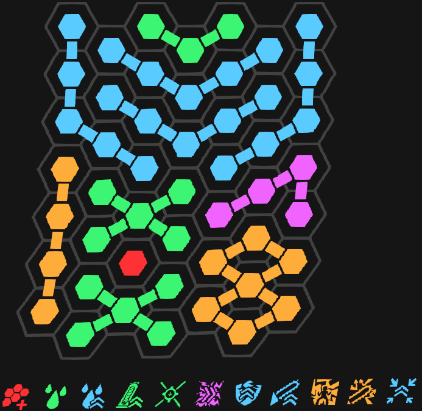

**Upgrades:** Boundary Incursion,Blood Efficiency,Blood Rampage,Additional RAM Stick,Blade Extenders,Shocking Adrenaline,Safety Warning,Swinging Technique,Rage,Deflector,Aim for the Liver

**Comments:**  
Carver does not work in the Amalgam hunt. Since it has 2 types of stacks that are both gained on target kill, we essentially are running a stackless Carver. Not to meantion that blood falls off while still in combat which is wild. We use Photon Disc instead of Incendiary Grenade since it will be more consistent damage for this build rather than relying on fire saturation from the enemy for Give and Take and Focus Prism. In a normal mission this build is horrible, the standard build just doesnt work here.

---

### Mycologist – Melee
**Kill Time:** 01:18.182

**Secondary:** Swarm Launcher - Guidance Array
**Grenade:** Incendiary Grenade - Internal Combustion
**Elemental Cocktail:** Fire to Acid

**Upgrades:** Boundary Incursion,Elemental Health,Elemental Regeneration,Kaleidoscopic Retort,Angry Outburst,Focus Prism,Mycelial Battery,Structural Support,Adrenaline Cultivation,Elemental Cocktail,Mushroom Cap

**Comments:**  
Theres 2 ways to build a melee build, Glider's From Downtown, and Mycologist's Angry Outburst. Angry Outburst is the only one that will kill the Amgalamation in any sane amount of time. Melee is a horrid option, but it is actually kind of fun. In a real mission this will never work. Essentially you are meleeing and watching your infection meter / health bar. You need to constantly be air sliding for Grenade Belt, watching your Grenade Cooldown, and Fungal Skewer Cooldown, in order to survive.

---

### Glider – M.I.R.V.
**Kill Time:** 01:54.197

**Secondary:** Swarm Launcher - Guidance Array
**Grenade:** Incendiary Grenade - Internal Combustion
**Elemental Cocktail:** n/a

**Upgrades:** Boundary Incursion,Elemental Tips,High-Velocity Targeting,Clearing Charge,Pocket Rocket,Rearm Mechanism,Nanite Return,Kernel Rerouter,M.I.R.V.,Eye on You

**Comments:**  
If there is anything to say, dont run MIRV in any context. It isn't worth it, but this is merely here to document its viability as a dedicated build. Since we are solo in testing we bring a Plate Launcher and place plates in the ground since they count as allies for Pocket Rocket to recharge our Salvos.

---

### Beam Ripper – Straggler's Revenge
**Kill Time:** 02:00.519

**Secondary:** Swarm Launcher - Munition Siphon
**Grenade:** Caustic Grenade - Heavy Support
**Elemental Cocktail:** Shock to Acid

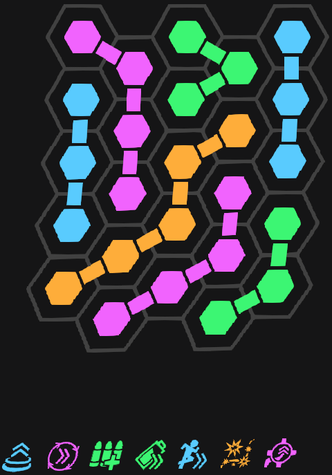

**Upgrades:** Inertial Overload,Safety Override,Battery Extension,Quick Charge,Running Hot,Straggler's Revenge,Energy Inversion

**Comments:**  
While this thing does do horridly, it is better than Inverted Spear of Hell. All heavy weapons are bugged so that any magazine or ammo capacity upgrades do not actually come filled when you spawn them. Making many builds worse.

---

### Globbler – Solidified Acid
**Kill Time:** 02:16.357

**Secondary:** Swarm Launcher - Guidance Array
**Grenade:** Voltaic Grenade - Livewire
**Elemental Cocktail:** Shock to Acid

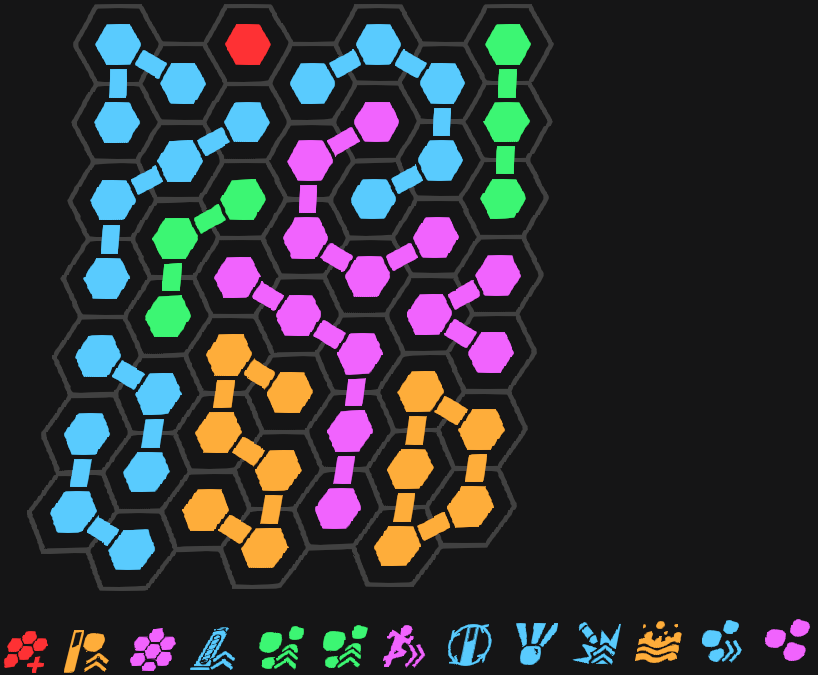

**Upgrades:** Boundary Incursion,Impact Funnel,Full Spectrum,Improved Replication,Globblin x2,Slipper Shoes,Glorb,Heavy Globs,Solidified Acid,Flood,Forceful Expulsion,Triagon

**Comments:**  
So this build is bad, but it has potential with a few buffs. We bring Voltaic Grenade to constantly damage ourselves with Livewire for Impact Funnel since we will be rapidly firing. We have Flood in this build, but we won't really be utilizing it since our globs are tiny and we cant really ground the Amalgam.

---

## F Tier

### Mycologist – Sporadic Sprouting
**Kill Time:** 03:28.737

**Secondary:** Swarm Launcher - Guidance Array
**Grenade:** Caustic Grenade - Connected Systems
**Elemental Cocktail:** n/a

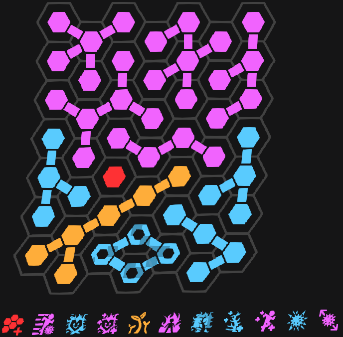

**Upgrades:** Boundary Incursion,Brisk Hypochondriac,Elemental Health,Elemental Regeneration,Sporadic Sprouting,Focus Prism,Exotic Flora,Mycelial Battery,Inertial Conductors,Chemical Reaction,Growth Hormones

**Comments:**  
Fungal Skewer build, much like Glider's Salvo build is here just for the sake of it, its a horrible build in terms of focusing on.

---

### Last Argument – Soul Reaper
**Kill Time:** 03:52.026

**Secondary:** Swarm Launcher - Munition Siphon
**Grenade:** Caustic Grenade - Heavy Support
**Elemental Cocktail:** Shock to Acid

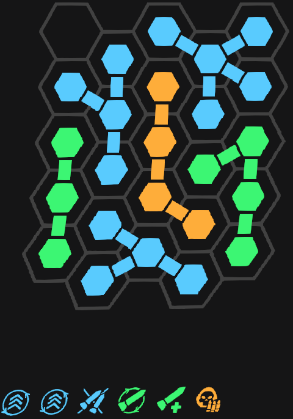

**Upgrades:** All the Time in the World x2,Where Did This Come From,Walk Cycle,Packed Payload,Soul Reaper

**Comments:**  
This weapon might actually be worse than Beam Ripper at boss killing (even though its a nuke launcher). Since Soul Reaper requires you to deal damage with your other weapon, i was technically cheating during the test to stack it and it still cant kill the Amalgamation in any relevant time. Worst weapon in the game hands down. All heavy weapons are bugged so that any magazine or ammo capacity upgrades do not actually come filled when you spawn them. Making many builds worse.

---

### Beam Ripper – Inverted Spear of Hell
**Kill Time:** 04:12.610

**Secondary:** Swarm Launcher - Munition Siphon
**Grenade:** Caustic Grenade - Heavy Support
**Elemental Cocktail:** Shock to Acid

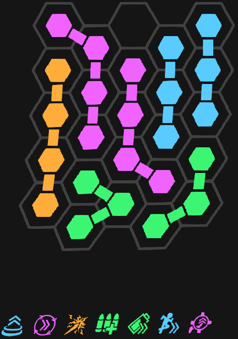

**Upgrades:** Inertial Overload,Safety Override,Inverted Spear of Hell,Battery Extension,Quick Charge,Running Hot,Energy Inversion

**Comments:**  
This weapon is just not made for Amalgamation killing. It needs desperate help in that regard. All heavy weapons are bugged so that any magazine or ammo capacity upgrades do not actually come filled when you spawn them. Making many builds worse.

---

